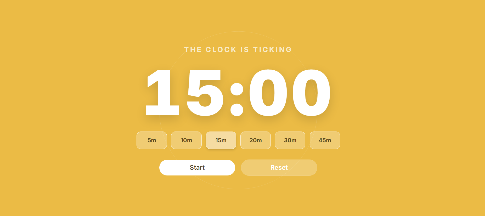

⏱️ Timer — Minimalist Countdown Timer

A clean, modern, and responsive countdown timer built with React, TypeScript, and Tailwind CSS.

Designed with simplicity in mind, Timer provides a distraction-free interface to manage time intervals with smooth animations and an intuitive user experience.

✨ Features
⏳ Countdown Timer: Displays minutes and seconds in real time.
🎯 Quick Time Selection: Choose between 5, 10, 15, 20, 30, and 45-minute intervals.
▶️ Start & Pause: Start the countdown or pause it whenever needed.
🔄 Reset: Restore the timer to the currently selected duration.
📱 Responsive Design: Adapted for mobile, tablet, and desktop screens.
🎨 Modern UI: Minimalist design with soft colors, rounded buttons, and subtle visual effects.
✨ Smooth Animations: Interactive hover, focus, and click transitions.
🛠️ Technologies
React — Component-based user interface.
TypeScript — Static typing and improved code reliability.
Tailwind CSS v4 — Utility-first styling and responsive layouts.
react-timer-hook — Countdown timer functionality.
Inter Variable — Typography.
📸 Preview

<!-- Add a screenshot of your application here -->

<!--  -->

🚀 Getting Started
Prerequisites

Make sure you have installed:

Node.js
npm, yarn, or pnpm
Installation
Clone the repository:
bash
git clone https://github.com/ezejuarezg/WebTimer.git

Navigate to the project directory:
bash
cd YOUR_REPOSITORY

Install dependencies:
bash
npm install

Start the development server:
bash
npm run dev

Open the local URL displayed in your terminal.
📂 Project Structure
text
src/
├── components/
│   └── Timer.tsx
├── App.tsx
├── index.css
└── main.tsx

The structure may vary depending on the project configuration.

🎮 How to Use
Select a countdown duration using one of the available time buttons.
Press Start to begin the countdown.
Press Stop to pause the timer.
Press Start again to resume.
Press Reset to restore the selected duration.
🎨 Design & Responsiveness

The interface uses a minimalist visual approach, combining:

A warm color palette.
Rounded and translucent buttons.
Responsive typography.
Smooth hover and active states.
Adaptive layouts for different screen sizes.
🗺️ Roadmap

Potential improvements for future versions:

Custom timer durations.
Sound notification when the timer finishes.
Dark and light themes.
Multiple timer presets.
Pomodoro mode.
Progress indicator.
🤝 Contributing

Contributions, suggestions, and improvements are welcome!

If you have an idea to improve the project, feel free to open an issue or submit a pull request.

📄 License

## 📄 License

This project is licensed under the MIT License.
See the [LICENSE](LICENSE) file for details.

Built with ❤️ using React, TypeScript, and Tailwind CSS.